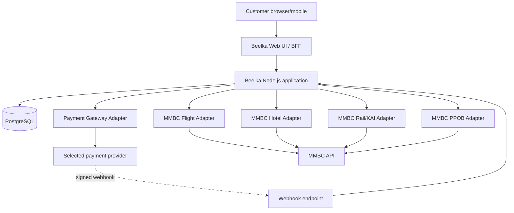

# Beelka — Architecture Blueprint

- Status: proposed architecture
- Architecture style: modular monolith with isolated provider adapters
- Runtime: Node.js LTS + TypeScript
- Customer UI: React / Next.js (recommendation; final choice is an ADR)
- Database: PostgreSQL
- Deployment: cloud platform with managed database and secret store
- Provider integrations: MMBC flight, hotel, rail/KAI and PPOB
- Payment: provider-neutral gateway abstraction; provider not yet selected

## 1. System context



## 2. Logical modules

- `identity`: customer account/session/authorization, profile minimization.
- `catalog`: product catalog snapshots, provider readiness, reference lists.
- `search`: validation and read-only search facade.
- `pricing`: quote records, expiry, total breakdown, price revalidation.
- `orders`: canonical internal order and state machine.
- `payments`: payment intents, provider webhooks, refunds/reversals.
- `fulfillment`: isolated service-specific workflows and reconciliation.
- `providers/mmbc-flight`: flight search, price check, booking, issue/status/e-ticket.
- `providers/mmbc-hotel`: country/city/hotel search, rate check, hold/payment-code, issue/status.
- `providers/mmbc-rail`: station list, schedule, price check, booking, seat/status/issue/e-ticket where supported.
- `providers/mmbc-ppob`: product list, bill check, purchase/payment, product-specific result handling.
- `audit`: append-only business/security events.
- `outbox`: durable messages to drive async workflows when needed.
- `support`: restricted operational lookup and reconciliation tools.

Avoid a generic adapter that erases product-specific semantics. Share transport, timeout and logging infrastructure, while each adapter owns its request/response mapping and state interpretation.

## 3. Proposed repository structure

```text
beelka/
├── apps/
│   ├── web/                     # public Next.js UI
│   └── api/                     # Node.js API, webhooks, health/readiness
├── packages/
│   ├── domain/                  # order/payment/fulfillment state machines
│   ├── contracts/               # input/output schemas
│   ├── db/                      # PostgreSQL connection, migrations, repositories
│   ├── observability/           # logging, metrics, correlation IDs
│   └── ui/                      # reusable customer UI components
├── providers/
│   ├── mmbc-flight/
│   ├── mmbc-hotel/
│   ├── mmbc-rail/
│   ├── mmbc-ppob/
│   └── payment-gateway/          # interface plus selected implementation
├── migrations/
├── tests/
│   ├── unit/
│   ├── contract/
│   ├── integration/
│   ├── e2e/
│   └── fixtures/
├── infra/
│   ├── docker/
│   └── cloud/                   # selected provider manifests/IaC
├── docs/
├── .github/workflows/
├── .env.example
└── package.json
```

Folder layout is a target blueprint, not a claim that all folders or runtime modules already exist.

## 4. Layer and dependency rules

1. UI only calls Beelka APIs; it never calls MMBC directly.
2. Domain logic depends on provider/payment interfaces, not vendor-specific code.
3. Provider adapters return typed normalized results plus safe original provider reference/state metadata.
4. Only application services may orchestrate orders, payment and fulfillment.
5. Database writes for order, payment state, audit and outbox are transactional where they share a consistency boundary.
6. Never hold a database transaction open across a network call to MMBC or payment gateway.
7. Persist intent/attempt first, call remote service outside DB transaction, then persist result and audit transition.
8. For unknown remote outcomes, enter reconciliation; do not infer failure and resubmit a chargeable mutation.
9. Use a transactional outbox when external side effects must be kicked off reliably after commit.
10. Store timestamps as timestamptz in UTC; render Asia/Jakarta unless product requirements change.

## 5. Canonical order and separate state machines

One internal order is the customer-facing source of truth, but payment and supplier fulfillment have separate states.

- Order: `DRAFT`, `QUOTED`, `AWAITING_PAYMENT`, `PROCESSING`, `COMPLETED`, `FAILED`, `CANCELLED`, `RECONCILIATION_REQUIRED`.
- Payment: `CREATED`, `PENDING`, `SUCCEEDED`, `FAILED`, `EXPIRED`, `REFUND_PENDING`, `REFUNDED`, `UNKNOWN`.
- Fulfillment: `NOT_STARTED`, `REQUESTED`, `PENDING`, `CONFIRMED`, `ISSUED`, `FAILED`, `UNKNOWN`, `RECONCILIATION_REQUIRED`.

Transitions must be defined and tested. Do not treat these proposed normalized values as exact MMBC statuses.

## 6. Suggested deployment topology

- CDN/WAF/reverse proxy in front of public web/API.
- Web/API runtime in managed container or application runtime.
- Managed PostgreSQL with private networking, automated backups and point-in-time recovery where available.
- Managed secrets and environment-scoped configuration.
- Async worker/outbox processor as a separate process if async workflows are introduced.
- Centralized structured logs, metrics, error tracking and alerting.
- Separate development, staging, and production environments.
- Deploy immutable artifacts; run migrations as a controlled release job.
- No secrets in browser bundles, logs, CI output, sample fixtures or public documents.

## 7. Availability and failure policy

- Search calls: bounded timeout, safe retry only for known idempotent reads, and provider-specific rate controls.
- Mutations: no blind retry after timeout; first query status if API supports it, otherwise reconcile manually.
- Payment webhooks: signature verification, durable event record, dedupe by provider event ID, acknowledge after safe persistence.
- PostgreSQL failure: readiness fails; no new transaction may be accepted.
- Supplier unavailable: make state explicit; do not show stale or fictional live availability.
- Circuit breakers and concurrency controls are introduced based on measured behavior, not assumed provider limits.

## 8. Architecture decision records

Create ADRs before decisions with long-lived impact:
- ADR-001 runtime/framework and monorepo tooling.
- ADR-002 payment gateway and account/legal eligibility.
- ADR-003 cloud provider and region.
- ADR-004 customer authentication/session strategy.
- ADR-005 retention/PII handling and privacy obligations.
- ADR-006 exact MMBC contract mappings and live-mode activation.
