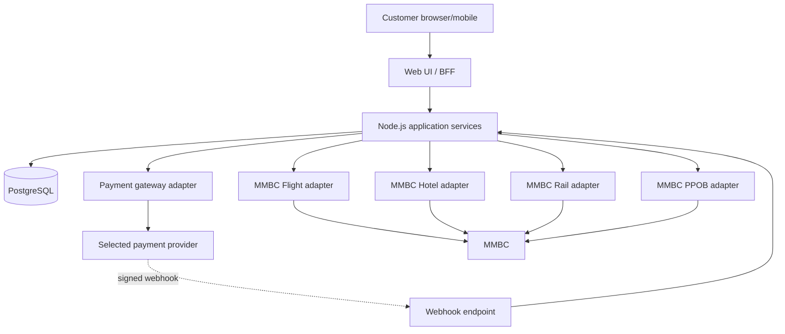

# Beelka — Architecture Blueprint

## Proposed stack
- Public web: React/Next.js (proposed; record final choice in ADR).
- Backend: Node.js LTS + TypeScript.
- Database: PostgreSQL.
- Deployment: cloud runtime, managed PostgreSQL, secret manager, HTTPS, backups, observability.
- Providers: isolated adapters for MMBC Flight, Hotel, Rail/KAI, PPOB and a provider-neutral payment gateway.
- Initial mode: explicitly simulated; live mutation and real payment disabled until verified.

## System context



## Logical modules
`identity`, `catalog`, `search`, `pricing`, `orders`, `payments`, `fulfillment`, `audit`, `outbox`, `support` and four separate provider adapters. Share transport/timeouts/logging utilities, but keep supplier-specific request/response mapping and state semantics inside each adapter.

## Target repository structure

```text
apps/web/                    # public customer UI
apps/api/                    # Node.js API, webhook, health/readiness
packages/domain/             # state machines and core rules
packages/contracts/          # request/response validation
packages/db/                 # repositories and migration tooling
packages/observability/      # logging, metrics, correlation IDs
packages/ui/                 # shared design system
providers/mmbc-flight/
providers/mmbc-hotel/
providers/mmbc-rail/
providers/mmbc-ppob/
providers/payment-gateway/
migrations/
tests/{unit,contract,integration,e2e,fixtures}/
infra/{docker,cloud}/
docs/
.github/workflows/
.env.example
```

This is a target layout, not a claim that these modules already exist.

## Architectural rules
1. Browser talks only to Beelka backend; MMBC credentials stay server-side.
2. Domain logic depends on interfaces, not vendor-specific payloads.
3. Persist internal intent/provider-attempt before remote mutation.
4. Never hold a DB transaction open across network calls.
5. Use a PostgreSQL transaction for related internal order/payment/audit/outbox writes.
6. Unknown remote outcomes move to `UNKNOWN` / `RECONCILIATION_REQUIRED`; no blind retry of chargeable actions.
7. Use transactional outbox for reliable post-commit work when async fulfillment is implemented.
8. Payment and supplier fulfillment have separate state machines.
9. Store timestamps as `timestamptz` UTC; render Asia/Jakarta by default.
10. Use bounded timeouts, safe retries for known read-only operations, correlation IDs and redacted structured logs.

## Proposed internal states
- Order: `DRAFT`, `QUOTED`, `AWAITING_PAYMENT`, `PROCESSING`, `COMPLETED`, `FAILED`, `CANCELLED`, `RECONCILIATION_REQUIRED`.
- Payment: `CREATED`, `PENDING`, `SUCCEEDED`, `FAILED`, `EXPIRED`, `REFUND_PENDING`, `REFUNDED`, `UNKNOWN`.
- Fulfillment: `NOT_STARTED`, `REQUESTED`, `PENDING`, `CONFIRMED`, `ISSUED`, `FAILED`, `UNKNOWN`, `RECONCILIATION_REQUIRED`.

These are internal normalized states, not asserted MMBC literal values.

## Cloud topology
CDN/WAF/reverse proxy; web/API runtime; managed PostgreSQL on private networking; secret manager; optional outbox worker; centralized logs/metrics/alerts; separate dev/staging/prod; immutable artifacts and controlled migrations. Backup and restore validation is a production gate.

## Required architecture decisions
ADR-001 framework/monorepo; ADR-002 payment gateway and refunds; ADR-003 cloud/region; ADR-004 auth/session; ADR-005 privacy/retention; ADR-006 current MMBC contracts/live enablement; ADR-007 currency and rounding; ADR-008 fulfillment ordering per service.