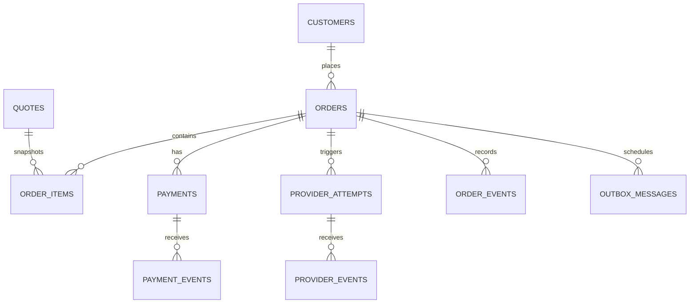

# Beelka — PostgreSQL Data Model

## Principles

- PostgreSQL is the internal source of truth for customer-visible order/payment state.
- Provider data is stored as references and controlled snapshots; the supplier remains authoritative for external booking status.
- Store money as integer minor units (`BIGINT`) with explicit currency or exact `NUMERIC(18,2)`; choose one convention and enforce consistently. Recommended: currency-aware minor units.
- UUID/ULID internal identifiers; separate external IDs.
- Use `timestamptz`, UTC at rest.
- Minimize personal data; encrypt or tightly restrict sensitive passenger/identity fields.
- Append audit events; do not silently rewrite financial state history.

## Entity map

## Tables and responsibilities

### `customers`
`id`, `email_normalized`, optional `phone_e164`, `display_name`, `auth_subject`, `created_at`, `updated_at`. Unique `auth_subject`; email uniqueness depends on auth policy. If using managed identity, do not store plaintext passwords.

### `quotes`
`id`, `customer_id`, `service_type`, `provider`, `request_hash`, `source_reference`, `quoted_amount_minor`, `currency`, `price_breakdown`, `terms_snapshot`, `is_simulated`, `quoted_at`, `expires_at`, `access_token_hash`, `consumed_at`. Expired or consumed quotes cannot create new orders. The mock API returns a random bearer token once and persists only its SHA-256 digest. Never persist/log the raw token; production quote ownership must bind to authenticated customer/tenant identity.

### `orders`
`id`, `public_order_number`, `customer_id`, `service_type`, `status`, `currency`, `subtotal_minor`, `fees_minor`, `discount_minor`, `total_minor`, `version`, `created_at`, `updated_at`. Unique `public_order_number`; use optimistic concurrency/row locks for transitions. A customer may access only their own orders.

### `order_items`
`id`, `order_id`, `quote_id`, `provider`, `product_code`, `description_snapshot`, `quantity`, `unit_amount_minor`, `total_amount_minor`, `supplier_reference`, `terms_snapshot_json`. Snapshot booking terms/price.

### `payments`
`id`, `order_id`, `gateway`, `gateway_payment_id`, `gateway_idempotency_key`, `status`, `amount_minor`, `currency`, `expires_at`, `paid_at`, `created_at`, `updated_at`. Unique gateway payment ID where non-null; amount/currency immutable once intent is created. Never store card PAN/CVV.

### `payment_events`
`id`, `payment_id`, `gateway_event_id`, `event_type`, `signature_valid`, `received_at`, `processed_at`, `payload_redacted_json`. Unique `(gateway, gateway_event_id)` for webhook deduplication.

### `provider_attempts`
`id`, `order_id`, `provider`, `operation`, `attempt_number`, `idempotency_key`, `request_hash`, `status`, `provider_reference`, `started_at`, `finished_at`, `error_code`, `safe_response_json`. Unique `(provider, operation, idempotency_key)`. Never blind-retry UNKNOWN.

### `order_events`
`id`, `order_id`, `sequence_number`, `from_status`, `to_status`, `actor_type`, `actor_id`, `reason_code`, `correlation_id`, `metadata_redacted_json`, `created_at`. Unique `(order_id, sequence_number)`; append-only for application roles.

### `audit_events`
`id`, `occurred_at`, `actor_type`, `actor_id`, `action`, `entity_type`, `entity_id`, `correlation_id`, `ip_hash_or_redacted`, `metadata_redacted_json`. Append-only permissions, limited visibility and explicit retention policy.

### `outbox_messages`
`id`, `aggregate_type`, `aggregate_id`, `event_type`, `payload_json`, `created_at`, `available_at`, `attempts`, `locked_at`, `processed_at`, `last_error_code`. Worker lease/retry logic and dead-letter/reconciliation process.

### `provider_reference_snapshots` (optional)
`provider`, `catalog_type`, `external_code`, `label`, `status`, `fetched_at`, `valid_until`, `payload_redacted_json`. Cache only where terms allow it and refresh SLA is defined.

## Database invariants

- Amounts are non-negative except explicitly signed refund/ledger entries.
- `total_minor = subtotal_minor + fees_minor - discount_minor` or one other documented formula; compute/verify server-side.
- Order/payment currency must match.
- A succeeded payment cannot silently transition to failed.
- Issued fulfillment requires provider evidence for the relevant product flow.
- Same idempotency key and same normalized request returns the same logical result; changed payload returns HTTP 409.
- Foreign keys use restrictive deletes for financial records.
- Sensitive columns are not copied to audit/event JSON by default.
- No destructive deletion of financial records; use retention/anonymization rules.

## Migration and repository policy

- Sequential immutable migrations (e.g. `0001_core.sql`, `0002_payments.sql`).
- Never edit an applied migration in shared environments; add a forward migration.
- CI tests migrations against ephemeral PostgreSQL.
- Backup and restore test required before production launch.
- Migration runs as a controlled deploy step; app startup should not race multiple migration runners.
